# OEM Solicitudes

Sistema web para la gestión de solicitudes de servicio eléctrico de Obras Eléctricas Mendivil.


| Dato | Valor |
| --- | --- |
| Universidad | Universidad Autónoma de Baja California (UABC) |
| Facultad | Facultad de Ciencias Químicas e Ingeniería (FCQI) |
| Materia | Aplicaciones Web |
| Grupo | 371 |
| Alumno | Mendivil Martinez Jaime |
| Matrícula | 2200608 |
| Profesora | Barriba Cazares Itzel |
| Fecha | noviembre de 2026 |

## Descripción del sistema

OEM Solicitudes es una aplicación web desarrollada como proyecto escolar para Obras Eléctricas Mendivil, empresa de servicios eléctricos ubicada en Tijuana, Baja California. La empresa recibe solicitudes por teléfono, WhatsApp, recomendación y de forma presencial, sin un registro común que permita conocer el estado de cada trabajo. El sistema concentra esas solicitudes en una base de datos única, asigna un folio y una prioridad a cada una y muestra el avance del servicio tanto al cliente como al personal administrativo.

La aplicación se ejecuta sobre PHP 8 con MySQL, sin frameworks de backend ni de front-end: la interfaz se construye con HTML5, CSS3 y JavaScript. Cada solicitud recibe un folio con el formato `OEM-AA-NNNN` (por ejemplo, `OEM-26-0050`), lo que facilita su identificación y seguimiento.

El sistema distingue dos roles:

- **Cliente.** Se registra, crea solicitudes, consulta el estado de las propias y las cancela mientras no avancen del estado `En revisión`.
- **Administrador.** Atiende el panel de trabajo, gestiona todas las solicitudes, mantiene el catálogo de servicios, consulta reportes y administra las cuentas y sus roles.

## Funciones implementadas

**A1–A4. Cuentas y sesiones**

- Registro de clientes con validación de nombre, correo, teléfono y contraseña.
- Inicio de sesión con mensaje genérico ante credenciales incorrectas.
- Cierre de sesión por POST con token CSRF.
- Roles `Cliente` y `Administrador`, con redirección del cliente que intenta abrir una ruta de administración.

**B1–B4. Solicitudes**

- Alta por el cliente con canal `Web` asignado automáticamente.
- Alta por el administrador con canal `WhatsApp`, `Llamada` o `Recomendación`, con cuenta vinculada o sin cuenta.
- Consulta: el cliente solo ve sus solicitudes; el administrador ve todas.
- Edición de datos, notas internas y cambio de estado validado en el servidor.
- Eliminación con confirmación y alternativa de cambiar el estado a `Rechazada` o `Cancelada`.

**C1. Búsqueda y filtros**

- Búsqueda por folio, nombre de contacto o teléfono.
- Filtros por estado, sector, canal de origen y rango de fechas.
- Orden por prioridad descendente y, dentro de cada prioridad, por antigüedad.
- Paginación de 10 registros.

**D1. Reportes**

- Cuatro indicadores: solicitudes por mes, por canal, por estado y visitas agendadas.
- Filtro por periodo, atajos para este mes, últimos tres meses y este año, y filtro por sector.
- Gráficas dibujadas con Canvas y SVG propios, sin CDN.

**E1–E2. Panel y usuarios**

- Panel del administrador con las tarjetas Nuevas, En revisión, Visitas próximas (7 días) y Recibidas en el mes, más la tabla «Atender primero».
- Listado de usuarios con búsqueda y cambio de rol entre `Cliente` y `Administrador`.

**F1–F3. Reglas del negocio**

- Prioridad calculada automáticamente a partir del sector y la escala; no se captura a mano.
- Panel del cliente con línea de seguimiento de siete etapas y cancelación limitada a `Enviada` o `En revisión`.
- Canal de origen registrado en cada solicitud y disponible para filtros y reportes.

**CRUD de servicios**

- Alta, consulta, edición y eliminación de servicios del catálogo.
- Solo los servicios activos aparecen en el formulario de solicitud.
- Un servicio con solicitudes asociadas no se elimina: se desactiva y se avisa al usuario.

## Modelo de datos

La base `oem_solicitudes` contiene tres tablas en InnoDB con `utf8mb4_unicode_ci`.

### `usuario`

| Campo | Tipo | Notas |
| --- | --- | --- |
| `id_usuario` | `INT` | Clave primaria, autoincremental |
| `nombre` | `VARCHAR(100)` | Obligatorio |
| `empresa` | `VARCHAR(100)` | Opcional |
| `correo` | `VARCHAR(120)` | Obligatorio y único |
| `telefono` | `VARCHAR(10)` | Diez dígitos |
| `contrasena` | `VARCHAR(255)` | Hash generado con `password_hash` |
| `rol` | `ENUM('Cliente', 'Administrador')` | Predeterminado `Cliente` |
| `fecha_registro` | `DATETIME` | Predeterminado `CURRENT_TIMESTAMP` |

### `servicio`

| Campo | Tipo | Notas |
| --- | --- | --- |
| `id_servicio` | `INT` | Clave primaria, autoincremental |
| `nombre` | `VARCHAR(80)` | Obligatorio y único |
| `descripcion` | `TEXT` | Opcional |
| `activo` | `TINYINT(1)` | Predeterminado `1` |

### `solicitud`

| Campo | Tipo | Notas |
| --- | --- | --- |
| `id_solicitud` | `INT` | Clave primaria, autoincremental |
| `folio` | `VARCHAR(11)` | Obligatorio y único |
| `id_usuario` | `INT` | Opcional; cuenta vinculada |
| `nombre_contacto` | `VARCHAR(100)` | Obligatorio |
| `telefono_contacto` | `VARCHAR(10)` | Obligatorio |
| `sector` | `ENUM('Industrial', 'Comercial', 'Residencial')` | Obligatorio |
| `escala` | `ENUM('Grande', 'Mediano', 'Pequeño')` | Obligatorio |
| `id_servicio` | `INT` | Obligatorio |
| `descripcion` | `TEXT` | Obligatorio |
| `ubicacion` | `VARCHAR(200)` | Obligatorio |
| `canal_origen` | `ENUM('Web', 'WhatsApp', 'Llamada', 'Recomendación')` | Predeterminado `Web` |
| `prioridad` | `TINYINT UNSIGNED` | Calculada por el servidor |
| `estado` | `ENUM` de nueve valores | Predeterminado `Enviada` |
| `fecha_visita` | `DATETIME` | Opcional; obligatoria al agendar visita |
| `notas_internas` | `TEXT` | Solo administración |
| `fecha_registro` | `DATETIME` | Predeterminado `CURRENT_TIMESTAMP` |
| `fecha_actualizacion` | `DATETIME` | Se actualiza en cada cambio |

**Llaves foráneas.** `solicitud.id_usuario` referencia `usuario.id_usuario` con `ON DELETE SET NULL` y `ON UPDATE CASCADE`, de modo que eliminar una cuenta conserva sus solicitudes como registros sin cuenta. `solicitud.id_servicio` referencia `servicio.id_servicio` con `ON DELETE RESTRICT`, lo que impide borrar un servicio en uso. Hay índices sobre folio, usuario, servicio, teléfono, sector, escala, canal, estado, prioridad con fecha, fecha de visita y fecha de registro.

**Prioridad.** Se obtiene de una matriz fija de sector por escala y se clasifica en tres niveles: `Alta` de 7 a 9, `Media` de 4 a 6 y `Baja` de 1 a 3.

| Sector | Grande | Mediano | Pequeño |
| --- | :---: | :---: | :---: |
| Industrial | 9 | 8 | 3 |
| Comercial | 7 | 6 | 2 |
| Residencial | 5 | 4 | 1 |

**Folio.** Se genera al guardar la solicitud con el prefijo `OEM-`, el año a dos dígitos y un consecutivo de cuatro dígitos (`OEM-26-0051`). La columna es única y el consecutivo se calcula dentro de una transacción.

**Flujo de estados.** La secuencia principal es `Enviada` → `En revisión` → `Visita agendada` → `Presupuesto` → `Aceptada` → `En progreso` → `Finalizada`. Desde `En revisión`, `Visita agendada` y `Presupuesto` se puede pasar a `Rechazada`, y una solicitud rechazada puede volver a `En revisión`. El estado `Cancelada` es posible desde `Enviada` hasta `En progreso`. `Finalizada` y `Cancelada` son estados finales. El servidor rechaza cualquier transición fuera de esta tabla y `Visita agendada` exige `fecha_visita`.

## Tecnologías

| Capa | Tecnología |
| --- | --- |
| Servidor | PHP 8 |
| Base de datos | MySQL |
| Estructura | HTML5 |
| Estilos | CSS3 |
| Interacción | JavaScript |
| Entorno local | XAMPP |

## Estructura del proyecto

```text
.
├── .gitignore
├── LICENSE
├── README.md
├── index.php
├── inicio.php
├── crear.php
├── editar.php
├── eliminar.php
├── login.php
├── registro.php
├── logout.php
├── panel.php
├── reportes.php
├── usuarios.php
├── servicios/
│   ├── index.php
│   ├── crear.php
│   ├── editar.php
│   └── eliminar.php
├── includes/
│   ├── database.php
│   ├── auth.php
│   ├── funciones.php
│   ├── header.php
│   ├── nav.php
│   └── footer.php
├── css/
│   └── styles.css
├── img/
│   └── panel-admin.png
├── js/
│   ├── app.js
│   └── reportes.js
├── sql/
│   └── oem_solicitudes.sql
└── docs/
    ├── README.pdf
    └── propuesta.pdf
```

## Instalación en XAMPP

1. Copiar la carpeta del proyecto dentro de `htdocs` con el nombre `Proyecto-Web`. En Windows la ruta es `C:\xampp\htdocs\Proyecto-Web`; en macOS, `/Applications/XAMPP/htdocs/Proyecto-Web`.
2. Iniciar los servicios de Apache y MySQL desde el panel de control de XAMPP.
3. Abrir `http://localhost/phpmyadmin`, entrar a la pestaña **Importar** y seleccionar el archivo `sql/oem_solicitudes.sql`. El script crea la base `oem_solicitudes`, sus tres tablas, ocho servicios y 64 solicitudes de ejemplo.
4. Revisar `includes/database.php`. Los valores predeterminados son `127.0.0.1`, puerto `3306`, base `oem_solicitudes`, usuario `root` sin contraseña, que corresponden a una instalación típica de XAMPP. Conviene ajustarlos si la instalación local usa otras credenciales.
5. Abrir `http://localhost/Proyecto-Web/` en el navegador.

## Cuentas de prueba

| Rol | Nombre | Correo | Contraseña |
| --- | --- | --- | --- |
| Administrador | Administrador OEM | `admin@oem.com` | `AdminOEM2026!` |
| Cliente | Laura Gómez | `laura.gomez@ejemplo.com` | `Cliente2026!` |
| Cliente | Roberto Mendoza | `roberto@manunorte.mx` | `Cliente2026!` |
| Cliente | Carlos Medina | `carlos.medina@ejemplo.com` | `Cliente2026!` |
| Cliente | Sofía Herrera | `sofia@sanrafael.mx` | `Cliente2026!` |

Las contraseñas se guardan en la base como hash bcrypt. Estos datos provienen del archivo SQL y son únicamente para pruebas locales.

## Guía de uso

### Cliente

1. Crear una cuenta desde **Crear cuenta**, con nombre, correo, teléfono y contraseña.
2. En el panel, elegir **Nueva solicitud** e indicar el sector, la escala, el servicio requerido, una descripción del trabajo y la ubicación.
3. Consultar el avance en el panel: cada solicitud muestra una línea de siete etapas, desde `Enviada` hasta `Finalizada`, y la fecha de visita cuando está agendada.
4. Abrir el detalle de una solicitud desde el panel para revisar sus datos y notas.
5. Cancelar una solicitud propia solo mientras se encuentre en `Enviada` o `En revisión`.

### Administrador

1. Revisar el panel al iniciar sesión: tarjetas de conteo, visitas de los próximos siete días y tabla «Atender primero».
2. Consultar la gestión de solicitudes en **Solicitudes**, con búsqueda por folio, cliente o teléfono, filtros por estado, sector, canal y fechas, y paginación.
3. Registrar solicitudes recibidas por WhatsApp, llamada o recomendación desde **Nueva solicitud**, con o sin una cuenta de cliente asociada, y anotar notas internas.
4. Abrir una solicitud para editar sus datos, agendar la visita y cambiar el estado entre las opciones permitidas.
5. Eliminar una solicitud desde la pantalla de confirmación, o bien cambiarla a `Rechazada` o `Cancelada` cuando la transición sea válida.
6. Mantener el catálogo en **Servicios**: crear, editar, desactivar o eliminar servicios. Si el servicio tiene solicitudes, el sistema lo desactiva en lugar de borrarlo.
7. Consultar **Reportes** con el periodo, los atajos de fecha y el filtro por sector.
8. Administrar las cuentas en **Usuarios** y cambiar el rol de un usuario entre `Cliente` y `Administrador`.

## Seguridad

- Todas las consultas usan sentencias preparadas de PDO con `ATTR_EMULATE_PREPARES` desactivado.
- Las contraseñas se almacenan con `password_hash` y se verifican con `password_verify`; la sesión se regenera al iniciar.
- Todo formulario POST incluye un token CSRF que se comprueba en el servidor, incluido el cierre de sesión y la eliminación de registros.
- Las salidas HTML se escapan con `htmlspecialchars` mediante la función `e()`.
- La validación se repite en el servidor aunque el navegador ya la haya aplicado con JavaScript.
- Cada página protegida verifica la sesión y el rol antes de mostrar contenido; un cliente que abre una ruta de administración se redirige a su panel.

## Capturas

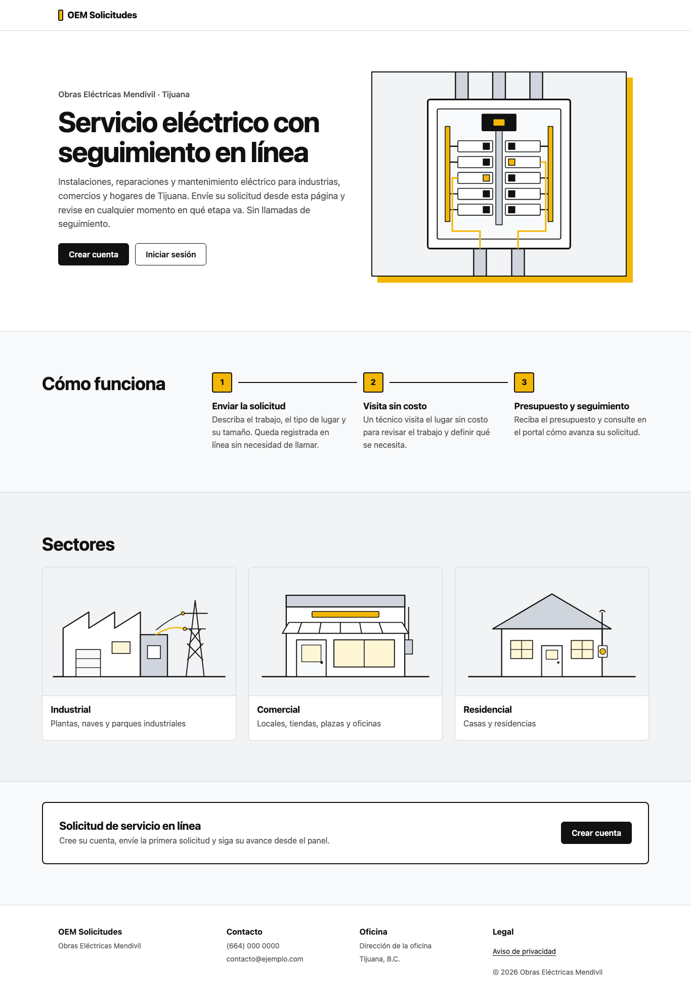

Página de inicio para visitantes sin sesión.

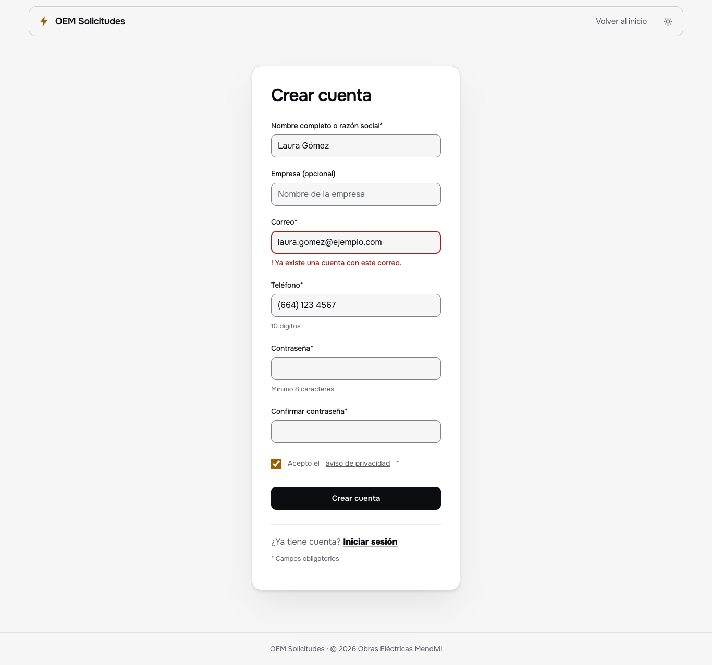

Registro de cuenta con mensaje de error por correo ya registrado.

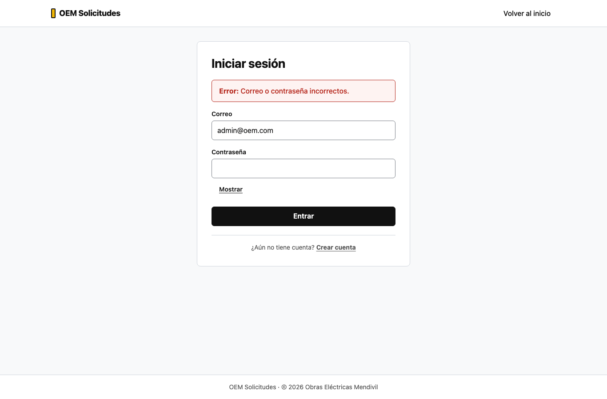

Inicio de sesión con mensaje de error por credenciales incorrectas.

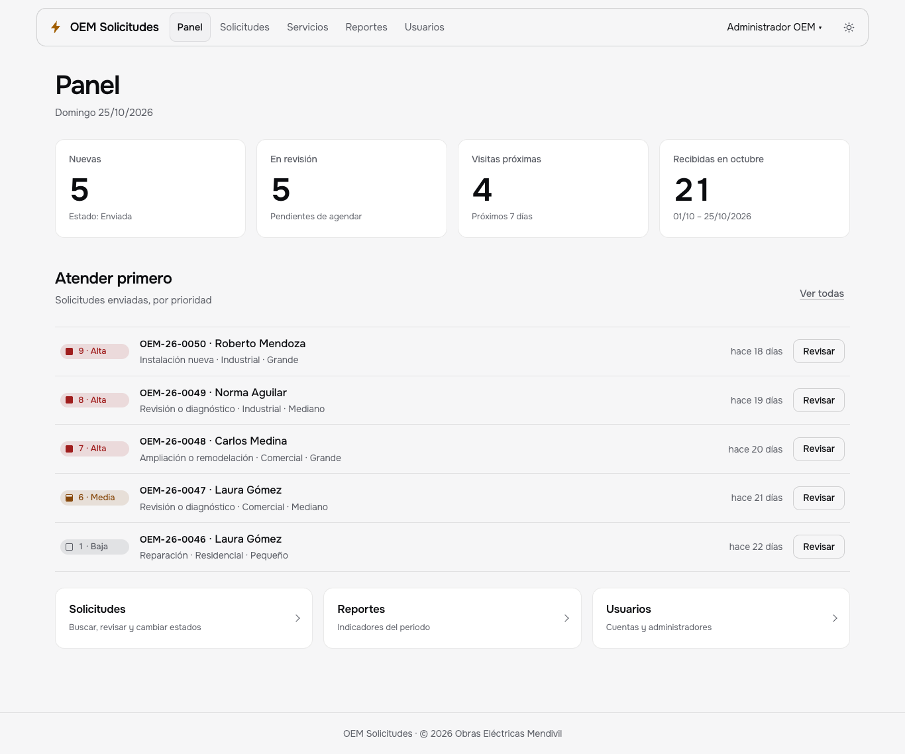

Panel del administrador con el resumen de solicitudes.

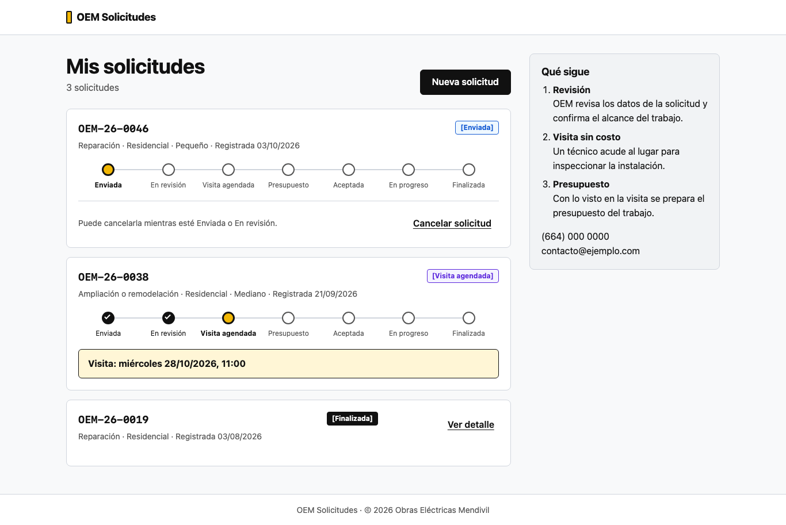

Panel del cliente con sus solicitudes registradas.

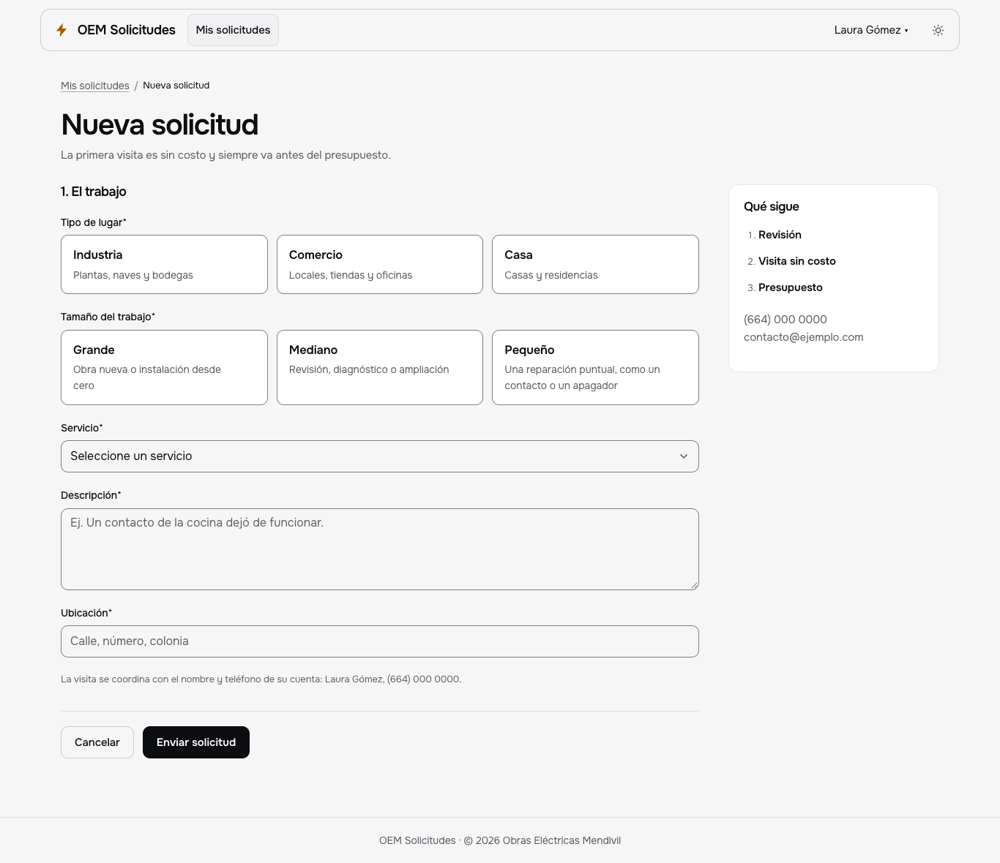

Formulario para crear una nueva solicitud de servicio.

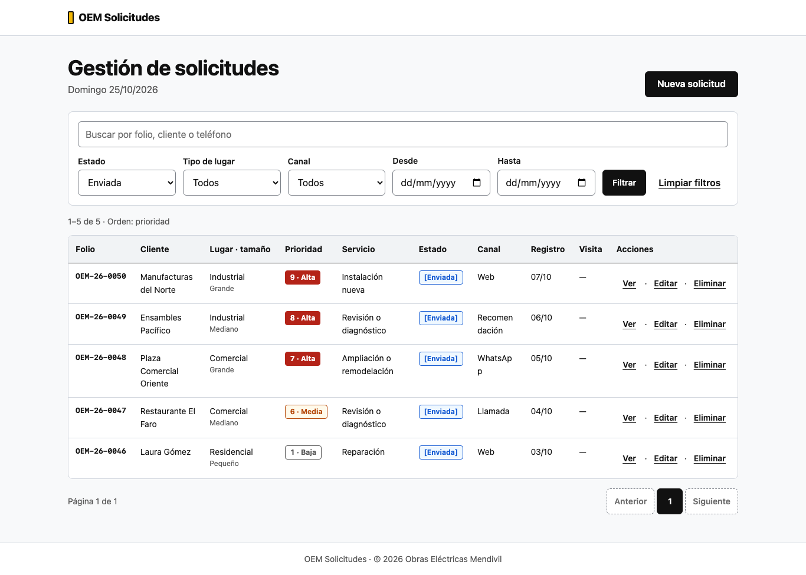

Listado de solicitudes del administrador con el filtro de estado Enviada aplicado.

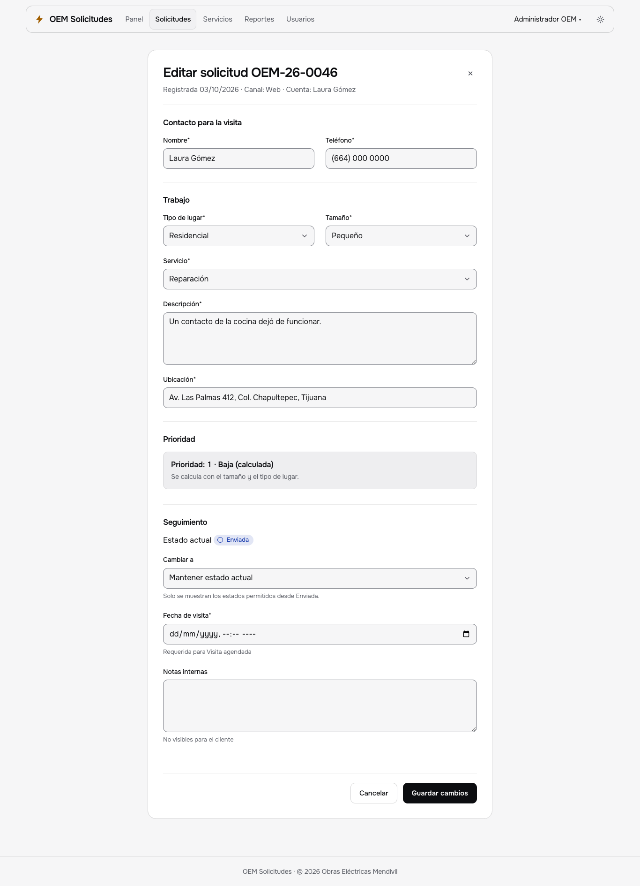

Edición de una solicitud con las opciones de cambio de estado.

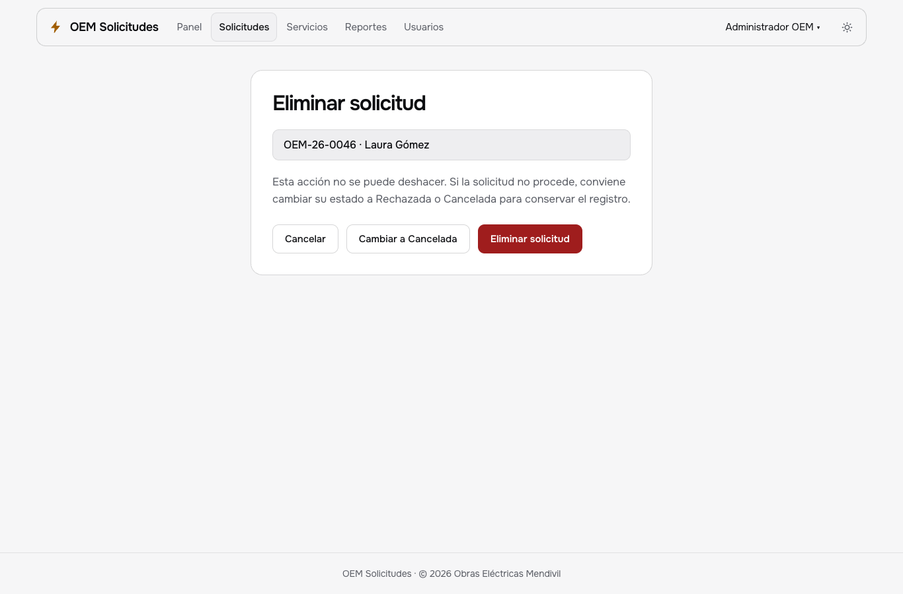

Pantalla de confirmación previa a la eliminación de una solicitud.

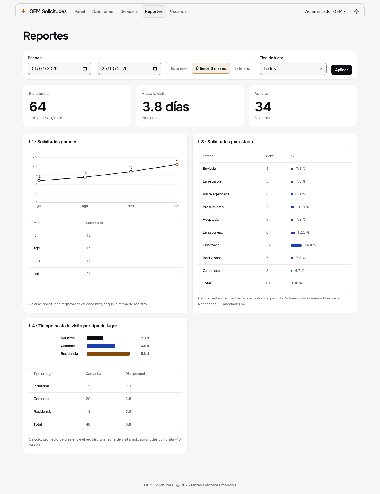

Reportes con indicadores y gráficas de las solicitudes.

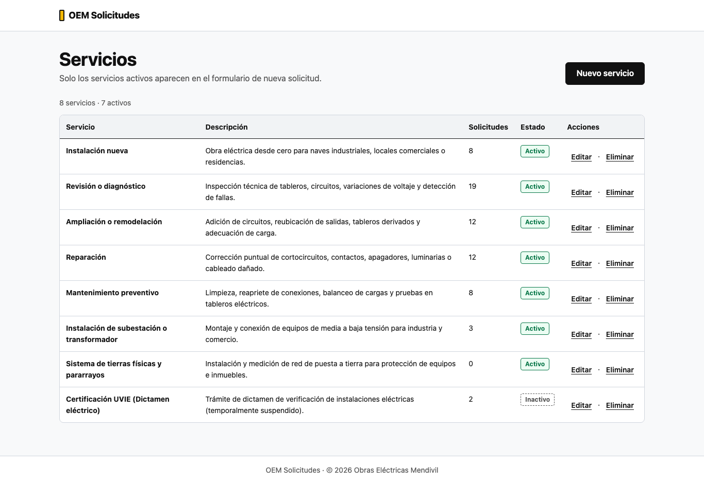

Catálogo de servicios disponible para el administrador.

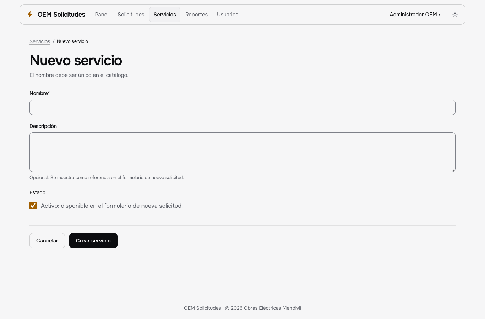

Formulario de alta de un servicio.

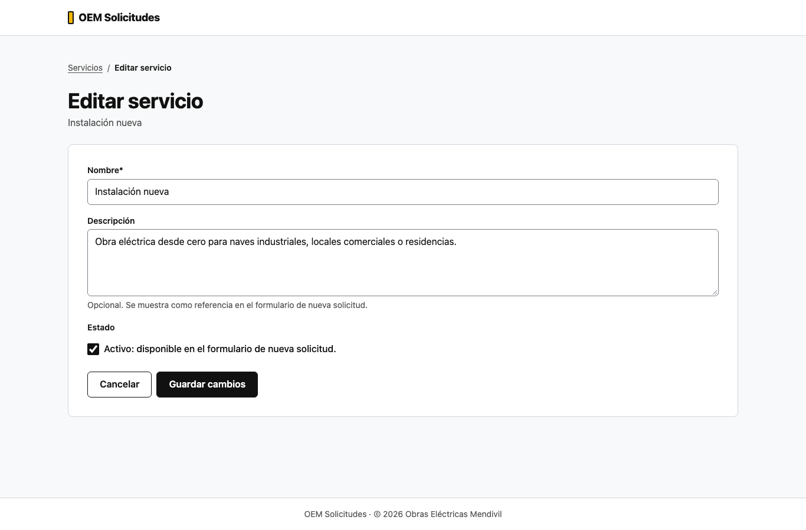

Formulario de edición de un servicio existente.

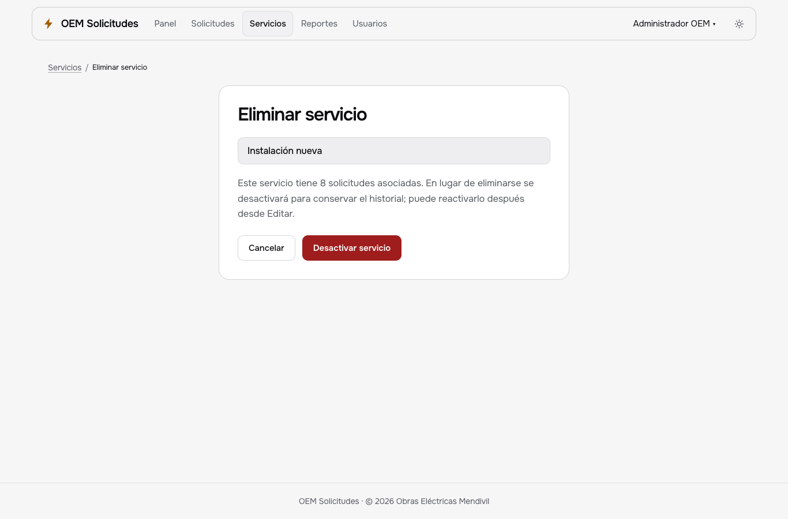

Confirmación de desactivación de un servicio que tiene solicitudes asociadas.

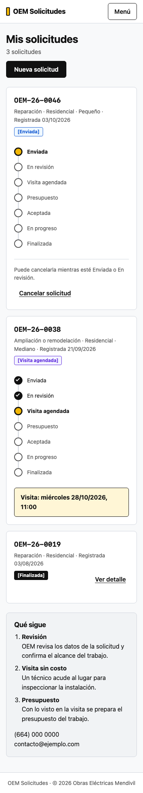

Panel del cliente en un ancho de 375 px.

## Licencia

Este proyecto se distribuye bajo la Licencia MIT. El texto completo está disponible en [LICENSE](LICENSE).
